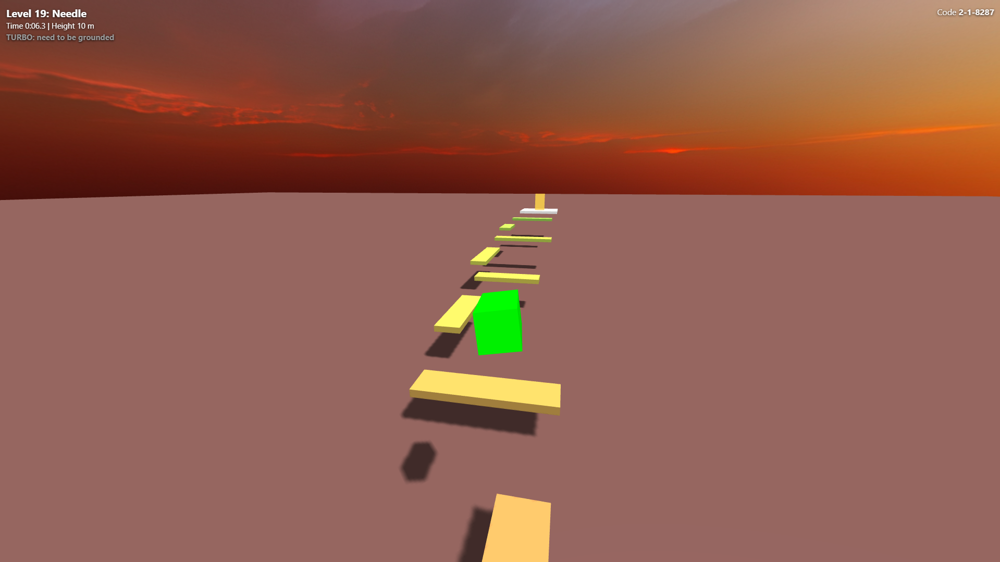
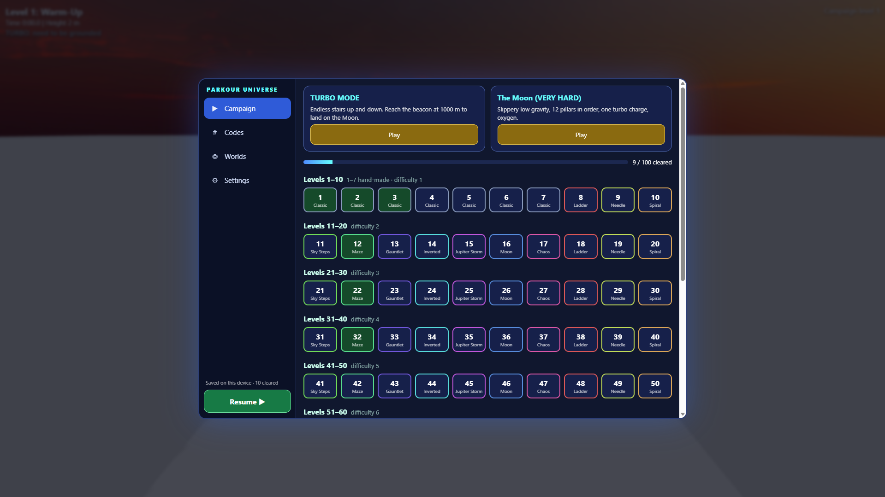
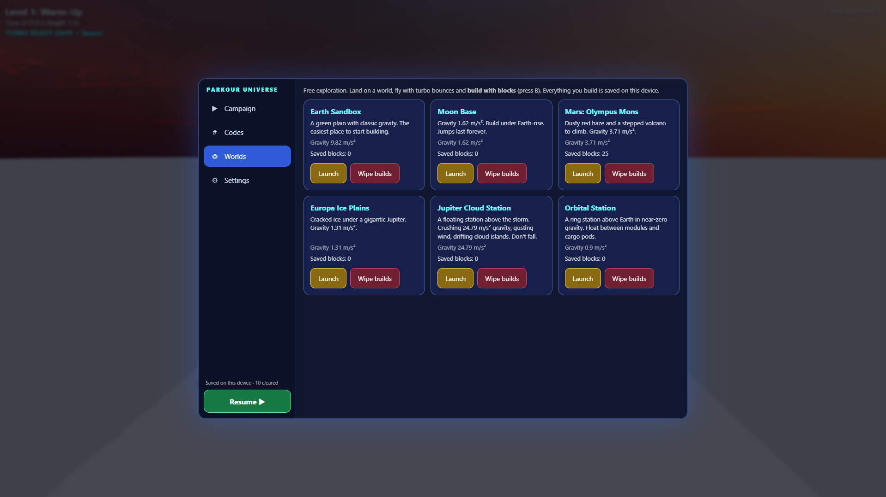
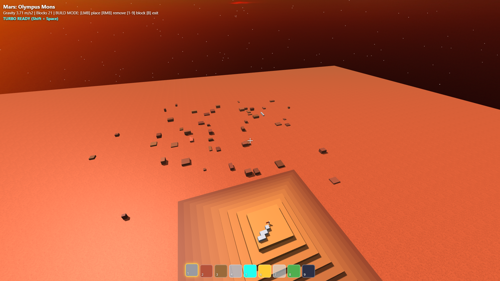

# 🌌 Parkour Universe

### A 3D parkour adventure across procedurally generated challenges and strange worlds.

**Jump higher. Move faster. Defy gravity. Build your own path.**

Parkour Universe is a browser-based 3D parkour game built around physics-based movement, seeded level generation, challenging obstacle courses, and space-themed environments. From narrow platforms and spiraling climbs to inverted gravity and powerful storm winds, every mode puts your movement skills to the test.

🎮 **[PLAY PARKOUR UNIVERSE](https://parkuniverse.netlify.app/)**



> **No installation required:** Play directly in your browser.

---

## 📸 Screenshots

*Add your own screenshots to the `screenshots/` folder in this repository, then replace these image paths with your filenames.*

| Main Menu | Parkour Gameplay |
|---|---|
|  |  |
| *Explore the game's menus and modes.* | *Jump between platforms and master your movement.* |

| Special Worlds | Build Mode |
|---|---|
|  |  |
| *Experience different gravity and environmental challenges.* | *Place and break blocks in supported worlds.* |

---

## ✨ Features

### 🧩 Procedurally Generated Parkour

Discover courses generated from level codes instead of relying exclusively on manually placed obstacle layouts. The game uses seeded generation, so the same valid level code reproduces the same generated level layout.

- Generate different obstacle arrangements using level codes.
- Adjust the challenge through a difficulty value.
- Return to a particular generated layout using its code.
- Explore different platform arrangements and level structures.

### 🏁 Multiple Challenge Types

The game includes **10 level types**, each designed around a different movement challenge.

| Level Type | What to Expect |
|---|---|
| **Ladder** | Classic jumps across platforms that climb upward. |
| **Spiral** | Circle a tower while making your way higher. |
| **Needle** | Navigate narrow beams and alternating platform directions. |
| **Sky Steps** | Tackle large vertical climbs and use turbo bounces. |
| **Maze** | Find your way through a procedurally generated maze. |
| **Inverted** | Take on levels where gravity pulls upward. |
| **Moon** | Navigate low-gravity pillars in order while managing oxygen. |
| **Gauntlet** | Combine long jumps, gaps, and demanding climbs. |
| **Jupiter Storm** | Fight powerful gravity and changing wind forces. |
| **Chaos** | Face a generated combination of several obstacle styles. |

### 🚀 Physics-Based Movement

Movement is central to the experience. Learn to manage momentum, judge distances, and time your jumps to reach difficult platforms.

- Standard jumping and movement.
- Sprinting to cover more distance.
- **Turbo Bounce** for powerful jumps in supported levels.
- First-person and third-person camera options.
- Checkpoints or respawning behavior in supported challenges.

### 🪐 Worlds With Different Rules

Parkour Universe changes more than the scenery. Some challenges change the physical rules you need to master.

- **Low gravity:** Experience longer, floatier movement on Moon-style courses.
- **Inverted gravity:** Navigate platforms with gravity pulling upward.
- **Storm winds:** Compensate for wind forces in Jupiter Storm challenges.
- **Environmental hazards:** Handle special objectives, oxygen limits, and falls in supported levels.

### 🧱 Build Mode

In supported space-world environments, switch to Build Mode and interact with the world using placeable blocks.

- Select different block types.
- Place blocks to change your surroundings.
- Break blocks when you want to adjust your construction.
- Experiment with your own routes and structures.

### 💾 Progress That Stays on Your Device

The game uses browser storage to preserve supported game data and settings.

- Keep track of completed campaign levels.
- Save supported progress between visits on the same browser and device.
- Retain preferences such as control sensitivity and gameplay settings.

**Note:** Saves are stored locally in your browser, not in an online account. Clearing site data or switching browsers or devices may affect saved progress.

### 📱 Desktop and Mobile Controls

The game includes keyboard-and-mouse controls and a touch-oriented interface for compatible mobile devices.

- Virtual movement joystick.
- Touch-drag camera control.
- On-screen jump, turbo, and sprint buttons.
- Touch controls for placing and breaking blocks in Build Mode.
- Mobile-friendly menus and gameplay settings.

---

## 🎮 How to Play

1. **Open the game:** Visit [parkuniverse.netlify.app](https://parkuniverse.netlify.app/).
2. **Choose a challenge:** Start a campaign level, explore available worlds, or enter a level code.
3. **Learn the movement:** Practice jumping, sprinting, and controlling your camera.
4. **Reach the goal:** Navigate the obstacles and complete the level's objectives.
5. **Experiment:** Try different level codes, challenge types, and environmental rules.
6. **Build:** Explore supported worlds and use Build Mode to place or break blocks.

---

## 🕹️ Controls

### Keyboard and Mouse

| Input | Action |
|---|---|
| `W` `A` `S` `D` | Move |
| Mouse | Look around |
| `Space` | Jump |
| `Shift` | Sprint |
| `Shift` + `Space` | Turbo Bounce, where supported |
| `V` | Switch first-person / third-person view |
| Mouse wheel | Zoom the third-person camera |
| `R` | Restart or respawn |
| `M` | Open the menu |
| `B` | Toggle Build Mode in supported worlds |

### Mobile

| Control | Action |
|---|---|
| Virtual joystick | Move |
| Drag on the right side | Look around |
| **JUMP** | Jump |
| **TURBO** | Turbo Bounce |
| **SPRINT** | Sprint |
| Build controls | Place or break blocks in supported worlds |
| On-screen menu buttons | Open menus, change view, respawn, and access other controls |

*Some actions are only available in particular level types or worlds. On mobile, rotate your device to landscape orientation.*

---

## 🛠️ Built With

Parkour Universe is implemented as a browser-based 3D game using:

- **HTML5** — Game page structure.
- **CSS3** — Interface styling, responsive layout, and touch controls.
- **JavaScript** — Gameplay systems, procedural generation, movement, and game logic.
- **[Three.js](https://threejs.org/)** — 3D rendering and scene management.
- **[Cannon.js](https://github.com/schteppe/cannon.js)** — Physics simulation.
- **IndexedDB** — Local storage for supported progress and settings.
- **WebGL** — Browser-based 3D graphics through Three.js.

The game loads its Three.js and Cannon.js libraries from a CDN, so an internet connection is generally required when opening the game.

---

## 🧬 How Seeded Level Codes Work

Level codes determine the generated challenge's type, difficulty, and seed.

The code is made from digits:

- **First digit:** Level type (`0`–`9`).
- **Second digit:** Difficulty setting (`0`–`9`).
- **Remaining digits:** Seed used to generate the layout.

For example, `483712` represents:

- Level type `4`: Maze.
- Difficulty digit `8`: The ninth difficulty setting.
- Seed `3712`: The seed value used for generation.

The same type, difficulty, and seed produce the same generated layout, making codes useful for revisiting a challenge or sharing a particular layout with someone else.

---

## 🌐 Play Online

**Play the live game:** [https://parkuniverse.netlify.app/](https://parkuniverse.netlify.app/)

The game runs in a modern browser that supports WebGL. Performance may vary by device, browser, and graphics hardware.

For the best experience:
- Use a current version of your browser.
- Close other demanding applications if performance is slow.
- On mobile, play in landscape orientation.
- Keep browser site data if you want to preserve locally stored progress.

---

## 💻 Run Locally

You can inspect or host the project using its HTML source.

1. Clone or download this repository.
2. Open the project folder.
3. Serve the HTML file from a local web server.
4. Open the served page in a modern browser with WebGL support.

For example, if the main game file is named `index.html`, you can use Python's built-in server:

```bash
python -m http.server 8000
```

Then open:

`http://localhost:8000`

A local web server is preferable to opening the HTML directly as a file, because browser storage and resource-loading behavior can differ between `file://` and HTTP pages.

---

## 🗺️ Project Goals

Parkour Universe brings together procedural level design, movement challenges, environmental variety, and player creativity in one browser-based experience.

The project focuses on:

- Making replayable parkour challenges through seeded generation.
- Creating level types that reward different movement skills.
- Exploring how gravity and wind can change platforming.
- Supporting both desktop and touch-based play.
- Giving players tools to experiment with their own structures.
- Keeping the game accessible through a browser.

---

## 📌 Current Scope

Features described in this README are based on the current game source. The uploaded version includes campaign and code-based levels, world modes, settings, local saving, and building controls in supported worlds.

Features such as online multiplayer, online leaderboards, cloud-synced accounts, and a dedicated daily-challenge system are not documented as available in this version.

---

## 🤝 Feedback

Found a bug or have an idea for a new level type, world, or movement mechanic?

Open an issue in this repository with:
- A short description of the problem or idea.
- Steps to reproduce a bug, if applicable.
- Your browser and device, if the issue is related to performance or controls.
- A screenshot or short recording, when useful.

Feedback helps identify improvements and new directions for Parkour Universe.

---

## 📄 License

Check the repository's `LICENSE` file for the terms under which the project can be used, modified, and distributed. If no license has been added yet, the project's reuse terms are not explicitly defined.

---

**Thanks for exploring Parkour Universe!**

🌌 *Find your route. Master your movement. Defy gravity.*

[**▶ Play Parkour Universe**](https://parkuniverse.netlify.app/)
